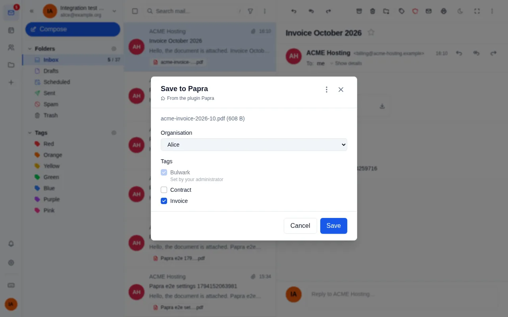
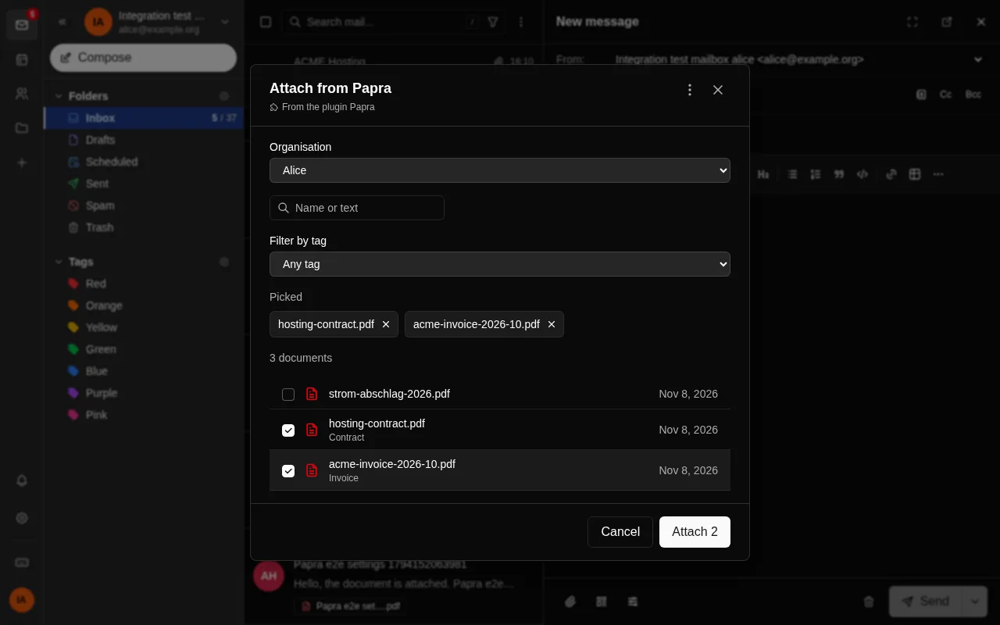
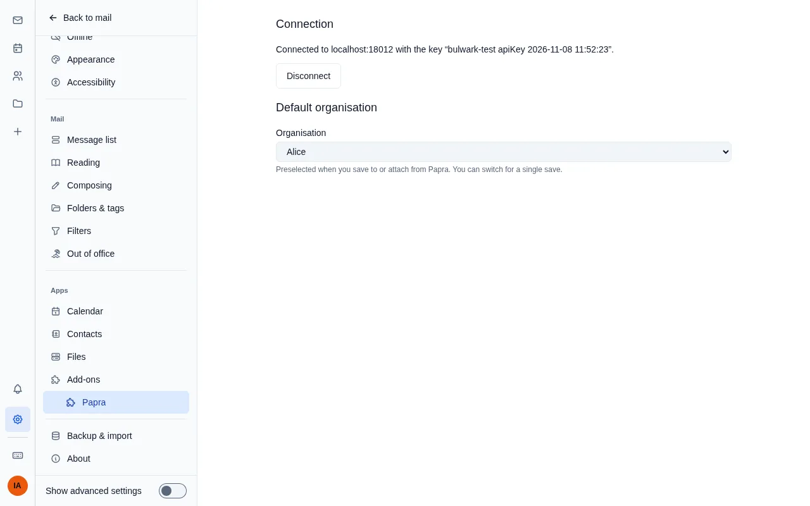

# Papra

Connects Bulwark to [Papra](https://papra.app), a document archive with
OCR and full-text search:

- **Save to Papra:** save an attachment as a document in one of your Papra
  organisations, with tags.
- **From Papra:** search Papra from the composer, filter by tag and attach
  documents to the message.



The plan and the decisions are in [docs/PLAN.md](docs/PLAN.md), how it is built in
[docs/architecture.md](docs/architecture.md).

## Setup for the admin

1. Install the plugin and set **Papra server URL** on its page in the admin
   dashboard. Users can only connect to this server.
2. Optionally set **Default tags**, for example `Bulwark`: every document
   saved from Bulwark gets them. Create these tags in each Papra
   organisation; the plugin creates no tags, and skips one an organisation
   doesn't have (the user is told).
3. If Papra is on a private network, Bulwark's plugin proxy has to be
   allowed to reach it. Add its origin to Bulwark's environment:

   ```
   PLUGIN_PROXY_PRIVATE_ORIGINS=https://papra.example.com
   ```

## Setup for users

Create an API key in Papra with these permissions:

| Permission | For |
|---|---|
| `organizations:read` | listing your organisations |
| `documents:read` | searching and attaching documents |
| `documents:create` | saving attachments |
| `tags:read`, `documents:update` | tagging saved documents (optional) |

Without the last two, documents are saved without tags. `documents:update`
also lets the key change the name, date and notes of documents, which you
can do in Papra yourself anyway. A Papra key always covers all your
organisations, private and shared.

Connect the key in Settings > Papra, or when the plugin first asks for it;
Bulwark shows a form with the server already filled in. Leave the server as it is:
a key connected to another server isn't used. The key stays on the Bulwark
server; the plugin never sees it.

## Using it

In Settings > Papra you can choose a default organisation; the dialogs
preselect it. Without one, you pick the organisation each time, so nothing
lands in a shared organisation by accident. The same page shows what your
key may do and disconnects it.

Open an attachment's menu in a message and choose **Save to Papra**. Pick
the organisation and any tags; the admin's default tags are already
ticked. Bulwark reads attachments up to
25 MB. If Papra already has the file, you are told so.

Writing a message, open **Attach** and choose **From Papra**. Search by
words in a document's name or text, narrow the list with **Filter by tag**
(several tags must all match), tick the documents and press **Attach**. Picked documents stay listed
above the results while you search on.



Each result shows its tags. Documents over 25 MB can't be attached this
way.

## Permissions

| Permission | Why |
|---|---|
| `http:proxy` | talk to Papra with your API key |
| `email:read` | the "Save to Papra" entry in each attachment's menu |
| `email:blob-read` | read the attachment you save |
| `ui:composer-toolbar` | the "From Papra" entry in the composer's Attach menu |
| `email:blob-write` | add the documents you pick to the message |
| `ui:observe` | the dialogs where you choose the organisation, tags and documents |
| `ui:settings-section` | the Papra page in Settings: connection and default organisation |
